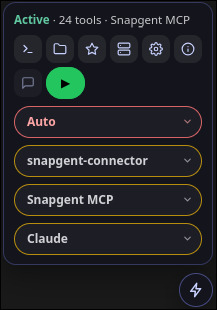
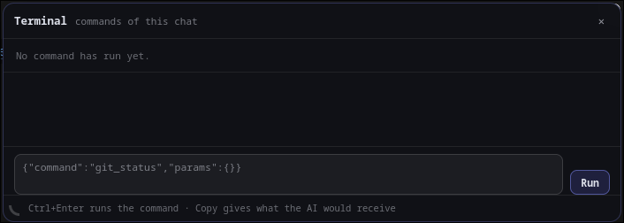

# Cara Pengunaan

Prasyarat :

@gambar(is-mcp-running.png)

1. Snapgent MCP sudah dijalankan (.exe untuk windows, snapgent untuk linux)

* Tombol pertama CMD, membuka popup terminal, run

* Dropdown pertama Auto, ada 3 mode Plan, Auto atau Manual. plan hanya boleh baca file mcp pasti menolak edit, Auto tanpa approval pengguna dan Manual tiap melakukan aksi selalu minta approval.
* Dropdown kedua snapgent-connetor, merupakan folder/workspace kerja yang dipilih. secara default Auto yaitu dengan mengambil dari kode editor vscode, antigravity, codex yang basenya vscode. disarankan pilih folder secara manual sebelum memulai sesi chat baru.
* Dropdown ketiga Snapgent MCP, tidak terlalu penting, secara default memilih mcp yang sudah dijalankan di Prasyarat 1.
* Dropdown keempat Claude, provider AI yang aktif di halaman yang sedang dibuka.
